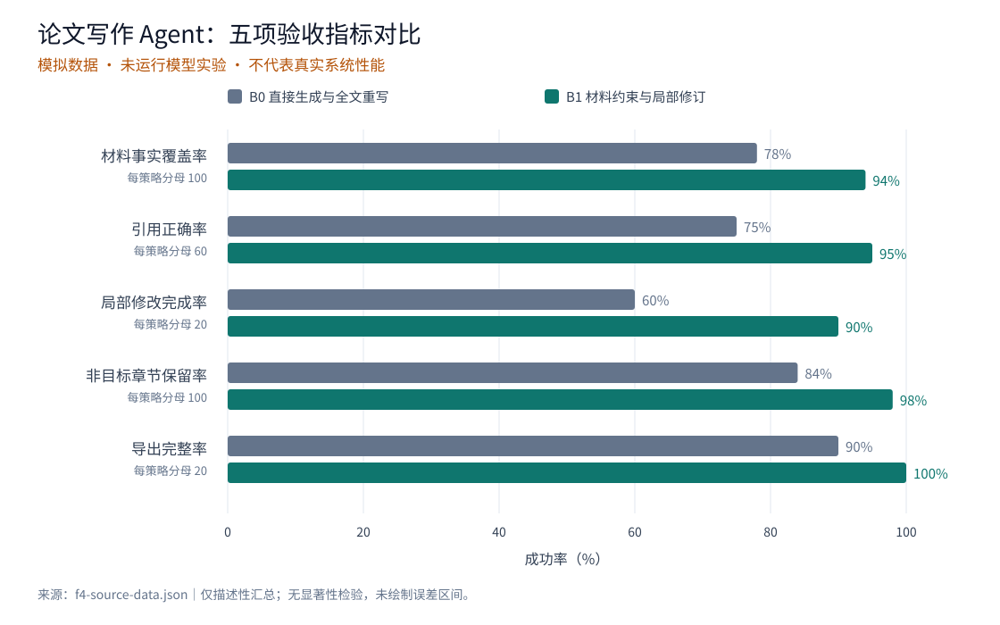
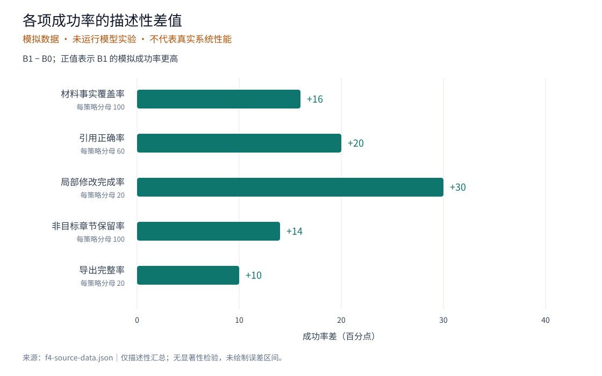

# LazyMind：基于可追溯研究材料与受限修订的论文写作 Agent

> 文件用途：F5 新稿写作的研究材料（materials），不是已有论文、不是待遵循的大纲，也不是单篇参考文献。研究主题是 LazyMind 的论文写作 agent。本文汇集研究说明、文献综述、核验后的文献目录、方法描述和实验结果材料，供先生成大纲、用户确认后写正文使用。
>
> 证据声明：方法描述来自当前项目代码阅读；外部文献仅核验原始 arXiv 页面上的题名、作者、版本及摘要，没有声称阅读全文。下面的实验数字是人工构造的验收 fixture，未运行模型实验，不能作为 LazyMind 的真实性能或真实验收通过记录。正文摘要、实验和结论都应保留“模拟数据演示”的性质。

## 一、研究说明

### 研究背景与问题

论文写作需要在多个阶段复用研究问题、文献依据、方法和实验结论。把这些内容一次性拼接成提示词，未必能保证生成稿件持续遵循材料边界：来源可能被遗漏，计划可能被写成已经完成的实验，局部润色也可能改动其他章节。本文把论文写作视为由材料、用户确认和修改范围共同约束的文档生成任务。

研究对象是 LazyMind paper-writing workflow 中的 F5，包括大纲生成、正文生成、已有稿件局部修订三个入口。F1–F4 是材料来源，本次测试不执行这些前置步骤；F6 审稿、PPT、模板套用及额外测试路径不属于本研究材料的验收范围。

研究问题如下：

- RQ1：如何让论文生成沿用用户确认的大纲，并区分来源事实、文献观点和待验证设想？
- RQ2：如何将正文引用绑定到明确的文献身份与书目条目，减少来源错配？
- RQ3：在“只改引言”的请求下，如何限定修改范围并保留其他章节和完整稿件？

### 研究目标与贡献定位

本文描述一种工作流层面的实现：用材料池保存输入及版本关系，把大纲确认作为正文生成前的交互节点，用文献目录限制新增引用，用定位和替换校验支持局部修订。贡献定位为系统设计及可检验的约束，不声称发明了新模型、训练方法或自动科学发现算法。

待验证假设是：相较于直接全文生成与全文重写，这些显式约束可能改善材料复用、引用可追溯性和非目标章节保留。现有模拟表格只用于演示如何报告这些指标，不能验证该假设。

### 写作范围

目标为中文研究论文，采用客观的研究表述。建议内容覆盖摘要、引言、相关工作、方法、实验设置与模拟结果、局限性、结论及参考文献；这些只是内容需求，不是已经确认的大纲。正文应保留两张数据表，并复用随附的两张 SVG 数据图；不重新生成图表或推导额外结论。不要添加作者单位、基金、伦理审批、模型型号、耗时、成本、显著性或未提供的实验。

## 二、文献综述

### 工具交互与任务组织

ReAct 研究交替组织推理与任务行动，使语言模型能够通过外部环境或知识来源获取信息。它为“生成过程需要显式行动与外部信息”提供背景；本文据此讨论写作中的材料读取与阶段组织，但不能将其问答、事实核验和交互任务结果视为论文写作质量证据。[ref-react]

### 反馈与文本修订

Self-Refine 使用同一个语言模型进行初始生成、反馈和迭代改进，不要求额外训练。它为将修订作为独立阶段提供背景。LazyMind 本次测试采用用户提出的局部修改要求，关注修改边界；与模型自行反馈的迭代过程存在区别，不能据此宣称实现或复现 Self-Refine。[ref-self-refine]

### 长上下文与材料利用

Lost in the Middle 在多文档问答和键值检索任务中考察相关信息的位置，报告模型利用长上下文时存在位置敏感性。它提示不能仅凭“材料已放入上下文”就认定材料得到正确使用。本文提出逐项检查材料事实和引用，但尚未验证材料池或章节规划能消除位置偏差。[ref-lost-middle]

### 综合与研究边界

文献核验日期为 2026-10-23，范围限于 arXiv 原始页面的书目信息及摘要。下列观点为摘要释义，不是原文引语；参考文献使用 arXiv 年份，未将预印本与正式出版版本混同。

上述工作分别涉及交互行动、反馈修订和上下文利用；本文组合这些视角，将关注点收敛到论文写作中的来源追溯、确认后生成以及受限修改。这个联系是本研究的设计解释，不是三篇文献提出的统一结论。仅凭三篇摘要不能证明领域不存在其他同类系统，因此不使用“首次”“唯一”或“全面优于已有方法”的表述。

## 三、方法描述

### 材料组织与来源边界

F1 的 question 与 F2 的 evidence 为 Markdown 文本；F2 同时输出 papers 列表。每篇来源保留稳定 id、title、text 或 abstract，citation 提供书目信息。F3 的实验输出包含实验方案、执行状态和结果表；F4 使用结构化 analysis 和 charts 表达分析结果及图表。F5 不负责重新运行实验。

对本文件这类汇总 Markdown，上传适配器将材料归入 writing_materials。它不会仅凭本文中的字段名自动生成独立 question、evidence、papers 或 analysis。本文件是可阅读的材料表达；配套 JSON 才是字段化入口，现已提供符合 F4 输出契约的 analysis 和 charts，其中 findings 位于 analysis.findings。研究方法和本次模拟结果放入 writing_materials，不能误称为真实 F3/F4 执行产物。

### 大纲确认与正文生成

write_outline 读取材料并生成独立大纲，用户可编辑保存。确认后进入 write_document；正文入口要求已有大纲，按章节规划生成、组装全文，并检查结构、引用及一致性。正文输出 manuscript，独立大纲继续保留，不从正文反向重建。这个交互设计允许用户在长文生成前检查研究论述的组织方式。

### 引用追溯

只有 papers 中带非空 citation 的条目进入新增引用候选目录。生成阶段的引用使用稳定文献 ID，发布时按首次引用次序生成显示编号及参考文献区域。编号变化不等于来源身份变化。引用格式合法也不意味着引用在语义上正确，仍需对照本文的“可支持/不支持观点”核验。

### 局部修订

revise_document 接收已有稿件和本轮明确请求。对于“引言太像产品介绍，改成研究论文写法，其他章节先别动”，期望只在引言范围内调整背景、研究问题和贡献表述。实现复用公共 Writer 的定位、修改计划和字符串替换能力，并校验操作范围及引用。直接修订不需要先运行 F6。功能设计不能代替实际测试；是否保留了其他章节应通过修订前后内容对比确认。

### 产物与完整性

大纲、正文及修订稿作为独立步骤产物发布。完整性应覆盖最终全文、表格和参考文献，不能仅检查流式预览。局部修订后导出的应是完整修订稿，而非只有引言的片段。

## 四、实验设置与结果材料（全部为模拟数据）

### 数据来源与实验状态

experiment_id：f5-fixture-20261023；execution_status：not_run；data_origin：synthetic。

以下为人工编写的汇总计数，用于测试模型能否忠实复用数据、解释指标并保留证据边界。没有真实任务集、逐任务日志、人工评分记录或模型运行记录。不得表述为“我们完成了 20 次真实实验”或“已通过 20 项验收”。未提供随机种子，因为这些计数并非随机程序采样所得。

### 演示评价设计

设想比较两种策略：B0 直接从同一材料生成全文，并在收到局部修改请求后重写全文；B1 使用本文的材料组织、大纲确认及局部修订流程。演示数据设定为每种策略各 20 个任务，每个任务包含 5 项必需事实、3 个规定引用位置、1 次引言修改请求、5 个非目标章节和 1 次全文导出。

真实实验还需固定模型版本、采样参数、上下文预算、输入材料、人工确认行为及评价者规则；这些均未实测，不能补写具体值。B0 与 B1 是演示对照名称，不是已运行模型的名称。

### 指标定义

| 指标 | 分子 | 分母 | 判定口径 |
| --- | --- | --- | --- |
| 材料事实覆盖率 | 正确呈现的必需事实数 | 100 项 | 不遗漏、不改写数值及证据性质 |
| 引用正确率 | 来源匹配且支持对应论述的位置数 | 60 个规定位置 | 缺引、错引、无来源均计为失败 |
| 局部修改完成率 | 引言完成目标修改的任务数 | 20 个任务 | 由规定的研究写法评价规则判定 |
| 非目标章节保留率 | 修订前后内容一致的非目标章节数 | 100 个章节 | 统一换行后逐字比较，不忽略数字或标点变化 |
| 导出完整率 | 全文导出完整的任务数 | 20 个任务 | 标题、正文末尾、两张表和文献列表均存在且内容一致 |

### 表 1：模拟汇总结果

| 策略 | 事实覆盖 | 引用正确 | 局部修改完成 | 非目标章节保留 | 导出完整 |
| --- | --- | --- | --- | --- | --- |
| B0 直接生成与全文重写 | 78/100（78%） | 45/60（75%） | 12/20（60%） | 84/100（84%） | 18/20（90%） |
| B1 材料约束与局部修订 | 94/100（94%） | 57/60（95%） | 18/20（90%） | 98/100（98%） | 20/20（100%） |

### 表 2：模拟差值及错误计数

| 指标 | B1 减 B0（百分点） | B0 未达标数量 | B1 未达标数量 |
| --- | --- | --- | --- |
| 材料事实覆盖率 | +16 | 22 项事实 | 6 项事实 |
| 引用正确率 | +20 | 15 个位置 | 3 个位置 |
| 局部修改完成率 | +30 | 8 个任务 | 2 个任务 |
| 非目标章节保留率 | +14 | 16 个章节 | 2 个章节 |
| 导出完整率 | +10 | 2 个任务 | 0 个任务 |

### 可写入正文的结果解释

在这份模拟表中，B1 的引用正确率为 95%，比 B0 的 75% 高 20 个百分点；这里不是“提高 20%”的相对变化。B1 非目标章节保留率为 98%，仍有 2 个章节发生变化，因此不能写成“绝不影响其他章节”。不同指标的失败可能发生于同一任务，不能把失败数相加推导总失败任务数。100% 的模拟导出完整率也不能代表软件已实现所有格式的无损导出。

上述差异仅展示指标口径和预期报告形式，不证明方法优越性、统计显著性或因果关系。没有逐任务配对观测，不能补充置信区间、p 值或方差。

## 五、局限性与结论边界

本研究材料可支撑系统方法描述及模拟结果展示，不能支撑真实效果结论。外部文献核验限于摘要和书目信息，尚不足以形成全面系统综述；模型、提示词、人工确认及实现细节可能共同影响结果。真实验证需要保存输入版本、确认大纲、生成稿、局部修订前后稿和导出文件，并进行逐项评价。

结论可表述为：本文给出以材料来源、用户确认与修改范围为约束的论文写作 agent 实现，并用模拟数据演示评价方法。它提供了可执行的验收对象，实际性能与泛化能力有待真实实验评估。

## 六、实验结果图（模拟数据）

### 图 1：五项验收指标成功率对比

B0 为直接生成与全文重写，B1 为材料约束与局部修订。图中依次比较材料事实覆盖率、引用正确率、局部修改完成率、非目标章节保留率和导出完整率；B0 分别为 78%、75%、60%、84%、90%，B1 分别为 94%、95%、90%、98%、100%。各指标按自身分母计算，不合并为总体成功率。全部数值为人工构造的模拟数据，未运行模型实验，不代表真实系统性能。

### 图 2：B1 与 B0 的成功率差值

按上述五项指标顺序，B1 减 B0 的成功率差分别为 16、20、30、14、10 个百分点。横轴表达绝对百分点差，不是相对提升百分比。图表仅描述同一份模拟汇总数据，不表示统计显著性或因果效果，也不提供置信区间。

## 参考文献

[ref-react] YAO S, ZHAO J, YU D, et al. ReAct: Synergizing Reasoning and Acting in Language Models[EB/OL]. arXiv:2210.03629, 2022[2026-10-23]. https://arxiv.org/abs/2210.03629.

[ref-self-refine] MADAAN A, TANDON N, GUPTA P, et al. Self-Refine: Iterative Refinement with Self-Feedback[EB/OL]. arXiv:2303.17651, 2023[2026-10-23]. https://arxiv.org/abs/2303.17651.

[ref-lost-middle] LIU N F, LIN K, HEWITT J, et al. Lost in the Middle: How Language Models Use Long Contexts[EB/OL]. arXiv:2307.03172, 2023[2026-10-23]. https://arxiv.org/abs/2307.03172.
